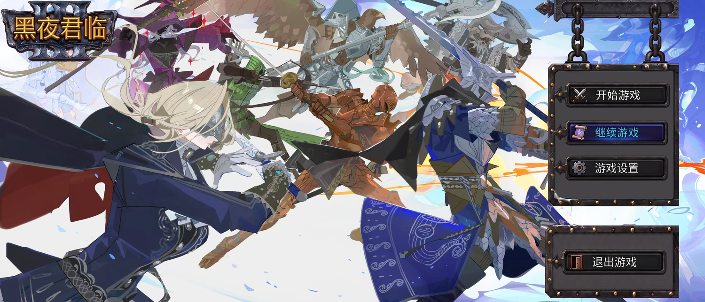
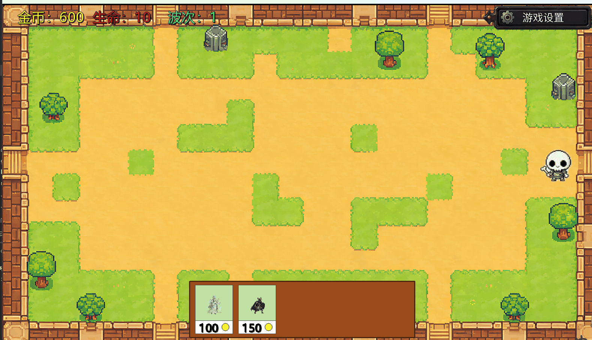
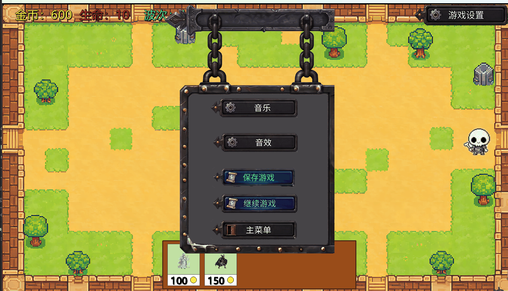
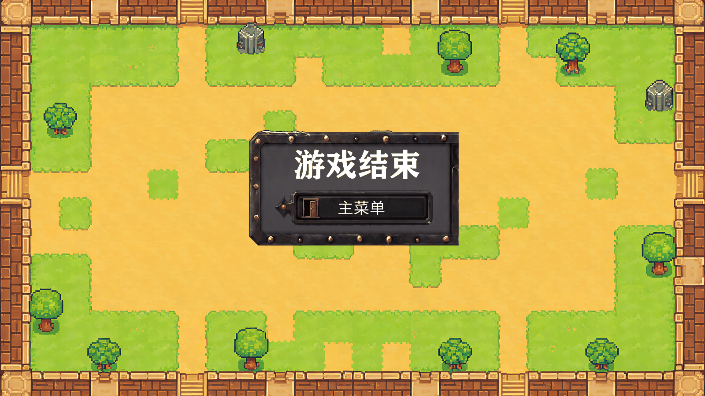

<div align="center">

# 黑夜君临 · Tower Defense

一个用 **libGDX** 编写的桌面塔防游戏，配套一套**前后端分离的关卡配置管理后台**。

游戏的所有数值、怪物、关卡与波次都由后台动态下发，客户端在离线时自动回退到本地缓存运行。

[](LICENSE)
[](https://libgdx.com/)
[](https://spring.io/projects/spring-boot)
[](https://vuejs.org/)
[](https://adoptium.net/)



</div>

---

## 目录

- [项目简介](#项目简介)
- [游戏截图](#游戏截图)
- [功能特性](#功能特性)
- [技术栈](#技术栈)
- [项目结构](#项目结构)
- [快速开始](#快速开始)
- [远程配置机制](#远程配置机制)
- [游戏数值](#游戏数值)
- [已知限制](#已知限制)
- [开源协议](#开源协议)

## 项目简介

本项目是一个完整的塔防游戏实现，由三个部分组成：

| 组成部分 | 说明 | 技术 |
| --- | --- | --- |
| **游戏客户端** | 1600×900 窗口的桌面塔防游戏，含主菜单、关卡选择、设置与关卡内战斗 | libGDX 1.13.1 |
| **管理后台后端** | 提供配置 CRUD 与面向客户端的只读运行时接口 | Spring Boot 2.7.18 + JPA + MySQL 8 |
| **管理后台前端** | 可视化编辑全部游戏配置 | Vue 3 + Element Plus + Vite 5 |

**核心设计**：游戏的关卡数量、怪物属性、波次编排、经济数值都不写死在客户端，而是由
管理后台维护并通过 REST 接口下发。策划改数值不需要重新编译游戏，玩家也不必更新客户端。

**离线可用**：客户端每次成功拉取配置后都会写入 `assets/runtime-cache/`，
当后台不可达时（未启动、网络异常、超时）自动读取本地缓存降级运行；
若连缓存都没有，则退回到代码中内置的默认数值。因此**直接运行游戏无需启动后台**。

## 游戏截图

<div align="center">

**关卡内战斗** — 左上角为金币 / 生命 / 波次，底部为可建造单位与造价



**暂停菜单** — 音乐、音效、保存游戏、继续游戏、返回主菜单



**结算界面**



</div>

## 功能特性

### 游戏客户端

- **网格建造系统**：24 × 14 网格地图，**路面格**可放置坚果墙阻挡敌人，**非路面格**可放置防御塔
- **塔防核心循环**：防御塔自动索敌射程内最近的敌人并发射子弹；坚果墙拦截敌人并每秒反伤
- **波次系统**：支持同一波次内多种怪物、多条路径、各自的刷怪数量与间隔，以及波次之间的停顿
- **路径驱动**：敌人沿 Tiled 地图中以 `Road` 开头的折线图层行进，支持一张地图多条路线
- **胜负判定**：漏怪扣生命，生命归零判负；打完最后一波且场上清空即通关
- **中文字体渲染**：基于 FreeType 动态生成字形，无需预烘焙位图字体
- **存档与设置**：持久化金币、生命、波次、建筑布局与音量，主菜单支持"继续游戏"
- **远程配置**：启动时拉取全局数值 / 怪物类型 / 关卡列表，进入关卡时按需拉取该关波次

### 管理后台

- **五类配置管理**：全局数值、怪物类型、关卡、波次、波次刷怪明细，全部支持增删改查
- **账号与权限**：`ADMIN` / `USER` 两级角色，按页面粒度分配可见菜单
- **两级接口**：管理端 CRUD 需登录；`/api/runtime/**` 免登录只读，仅供游戏客户端调用
- **级联删除**：删除关卡会一并清理其下所有波次与刷怪明细（事务保护）
- **数据校验**：编码唯一性、数值取值范围、刷怪引用的怪物类型是否启用，均在服务端校验
- **兜底配置**：全局数值不存在时自动写入一份默认配置，避免空库导致客户端拿不到参数

## 技术栈

| 层 | 技术 | 版本 |
| --- | --- | --- |
| 游戏引擎 | libGDX（含 FreeType 扩展） | 1.13.1 |
| 客户端构建 | Gradle Wrapper | 8.14.3 |
| 客户端 JDK | Java（`sourceCompatibility = 8`） | 17 |
| 后端框架 | Spring Boot / Spring Data JPA | 2.7.18 |
| 数据库 | MySQL | 8.x |
| 前端框架 | Vue 3 + Element Plus | 3.4 / 2.7 |
| 前端构建 | Vite | 5.2 |

代码规模（不含依赖与构建产物）：

| 模块 | 文件数 | 行数 |
| --- | ---: | ---: |
| `core` 游戏核心 | 17 | 3033 |
| `lwjgl3` 桌面启动器 | 2 | 235 |
| `manage/after` 后端 | 51 | 2696 |
| `manage/web` 前端 | 13 | 1263 |

## 项目结构

```
.
├── core/                          # 游戏核心逻辑（平台无关）
│   └── src/main/java/com/mygame/td/
│       ├── MainGame.java          # 入口，创建 SpriteBatch / 字体 / 加载远程配置
│       ├── config/GameConfig.java # 全局数值（可被后台覆盖）
│       ├── entity/                # Tower / Enemy / Bullet / Blocker / Explosion
│       ├── model/UnitType.java
│       ├── save/                  # 存档与设置的读写
│       ├── screen/                # 主菜单 / 关卡选择 / 关卡内 / 设置
│       └── service/RemoteConfigService.java   # 远程配置拉取与缓存回退
├── lwjgl3/                        # 桌面启动器与多平台打包
├── assets/
│   ├── audio/  font/  image/  map/
│   └── runtime-cache/             # 后台配置的本地缓存（运行时生成，不入库）
├── manage/
│   ├── after/                     # Spring Boot 管理后端
│   │   └── src/main/resources/
│   │       ├── application.yml
│   │       └── schema_mysql.sql   # 建表与初始数据
│   └── web/                       # Vue 3 管理前端
├── docs/screenshots/              # README 展示图
├── build.gradle
└── settings.gradle
```

## 快速开始

### 克隆仓库

```bash
git clone https://github.com/guanyang1517-oss/tower-defense.git
cd tower-defense
```

### 环境要求

| 用途 | 要求 |
| --- | --- |
| 运行游戏客户端 | JDK 17（Gradle 8.14 要求 17+） |
| 运行管理后端 | JDK 17、Maven 3.6+、MySQL 8 |
| 运行管理前端 | Node.js 18+ |

### 一、运行游戏客户端

```bash
# Windows
gradlew.bat lwjgl3:run

# macOS / Linux
./gradlew lwjgl3:run
```

**不需要启动后台即可游玩**：客户端会先尝试连接后台，失败后在 1.5 秒内回退到
`assets/runtime-cache/` 中的缓存。缓存不存在时使用代码内置的默认数值。

打包成可执行 JAR（产物在 `lwjgl3/build/libs/`）：

```bash
gradlew.bat lwjgl3:jar        # 当前平台
gradlew.bat lwjgl3:jarWin     # Windows x64
gradlew.bat lwjgl3:jarMac     # macOS
gradlew.bat lwjgl3:jarLinux   # Linux
```

> **注意**：游戏的存档与设置按 libGDX 的 `local` 语义写在**进程工作目录**下。
> 用 Gradle 运行时工作目录是 `assets/`，因此存档会出现在 `assets/save.json`，
> 这两个文件已被 `.gitignore` 忽略。

### 二、运行管理后台后端

1. 创建数据库并导入初始化脚本：

   ```sql
   CREATE DATABASE td_manage DEFAULT CHARACTER SET utf8mb4;
   ```

   ```bash
   mysql -u root -p td_manage < manage/after/src/main/resources/schema_mysql.sql
   ```

2. 通过环境变量提供数据库密码（**仓库中不保存任何密码**），然后启动：

   ```powershell
   $env:DB_PASSWORD = "你的数据库密码"
   cd manage/after
   mvn spring-boot:run
   ```

   可用的环境变量：`DB_URL`、`DB_USERNAME`（默认 `root`）、`DB_PASSWORD`。
   后端默认监听 `http://127.0.0.1:8080`。

3. 初始化脚本会植入默认管理员 **`root` / `root`**，**首次登录后请立即修改密码**。

### 三、运行管理后台前端

```bash
cd manage/web
npm install
npm run dev
```

访问 `http://127.0.0.1:5173`。开发服务器已配置代理，把 `/api` 转发到
`http://127.0.0.1:8080`，无需额外跨域配置。

### 四、让游戏使用你自己的后台

客户端的后台地址目前定义在
`core/src/main/java/com/mygame/td/service/RemoteConfigService.java` 的 `BASE_URL` 常量
（默认 `http://127.0.0.1:8080/api/runtime`）。部署到其他地址时修改该常量即可。

## 远程配置机制

```
游戏启动
   │
   ├─ GET /api/runtime/game-config   ──► 覆盖 GameConfig 中的全局数值
   ├─ GET /api/runtime/enemy-types   ──► 怪物类型表（仅 enabled=true）
   └─ GET /api/runtime/levels        ──► 关卡列表（仅 enabled=true）
                                          │
进入某个关卡 ──────────────────────────────┘
   └─ GET /api/runtime/levels/{code}/waves ──► 该关的波次与刷怪明细
```

约定响应格式为 `{"success": bool, "message": string, "data": ...}`，
`success != true` 即视为失败并触发缓存回退。每个请求最多等待
1.5 秒（连接）/ 3 秒（读取），失败后读取 `assets/runtime-cache/` 中同名 JSON，
命中则照常进入游戏，未命中才使用内置默认值——**所有失败路径都不会中断游戏启动**。

## 游戏数值

以下为内置默认值与初始化脚本中的种子数据，均可在管理后台中修改：

| 项目 | 默认值 | 项目 | 默认值 |
| --- | ---: | --- | ---: |
| 初始金币 | 600 | 防御塔造价 | 100 |
| 初始生命 | 10 | 防御塔射程 | 250 |
| 击杀奖励 | 50 | 坚果墙造价 | 150 |
| 怪物基础速度 | 150 | 坚果墙生命 | 1500 |
| 怪物基础生命 | 10 | 坚果墙反伤 | 1 / 秒 |
| 怪物攻击力 | 50 | 波次间停顿 | 5 秒 |

内置怪物类型（可由后台扩展）：

| 编码 | 名称 | 生命 | 速度 | 攻击 | 击杀奖励 |
| --- | --- | ---: | ---: | ---: | ---: |
| `1` | 兽人士兵 | 15 | 130 | 60 | 75 |
| `2` | 小骷髅 | 5 | 150 | 50 | 50 |

初始化脚本预置了 7 个关卡（含剧情节点的关卡名），实际使用 2 张 Tiled 地图；
第 3–7 关目前复用第 1 关的地图，可在后台按需重新指定。

## 已知限制

本项目为毕业设计作品，以下限制是已知且有意保留的，欢迎作为改进方向：

- **权限只在前端生效**：页面级权限（配置 / 怪物 / 关卡 / 波次）仅用于控制前端菜单显示，
  后端并未对相应的配置接口校验角色与页面权限，任何已登录账号都可直接调用这些接口
- **密码存储较弱**：账号密码使用**无盐 SHA-256** 存储，且登录校验是普通的字符串比较，
  未采用 BCrypt 等自适应哈希
- **登录态无持久化**：token 保存在服务进程内存中，重启即全部失效，且没有设置过期时间
- **配置接口全开放**：`/api/runtime/**` 免登录，任何能访问该地址的人都能读取全部配置
- **玩法深度有限**：防御塔只有一种且不支持升级 / 出售；子弹伤害固定为 1，未纳入远程配置
- **两套波次逻辑并存**：远程波次优先，后台无数据时回退到旧版硬编码波次，
  此时 `max_wave` 才参与胜负判定
- **无测试**：项目没有编写任何单元测试

## 开源协议

本项目**源代码**以 [MIT 协议](LICENSE) 发布，Copyright (c) 2026 yangguan。

请注意 MIT 协议**只覆盖源代码**。仓库中的字体、美术与音频素材不在授权范围内，
其中 `assets/font/` 下的微软雅黑（`msyh.ttc`、`msyhbd.ttc`、`msyhl.ttc`）为 Microsoft 所有的
专有字体；`StartupHelper.java` 来自 libGDX 的 gdx-liftoff 脚手架，以 Apache-2.0 分发。

完整的第三方组件清单与替换建议见 [THIRD-PARTY-NOTICES.md](THIRD-PARTY-NOTICES.md)。
二次分发或商用前请先替换为拥有合法授权的素材。
